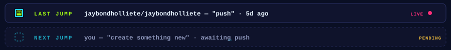
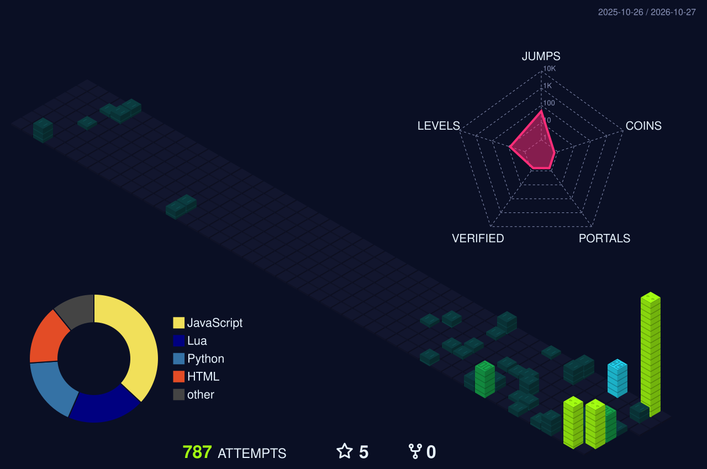
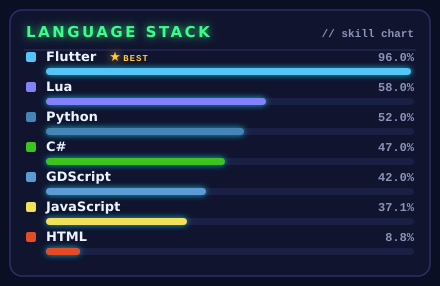
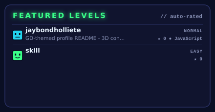

  

  

  

<h2 align="center">▶ &nbsp;THE CITY I BUILT THIS YEAR</h2>

every commit is a block. every day is a building.

  

  

<h2 align="center">◆ &nbsp;LOADOUT</h2>
<table align="center">
  <tr>
    <td width="50%" align="center"></td>
    <td width="50%" align="center"></td>
  </tr>
</table>

  

<h2 align="center">◇ &nbsp;ATTEMPT LOG</h2>

  
  

  

<h2 align="center">✦ &nbsp;PRACTICE RUN</h2>

the snake keeps farming the grid so you don't have to.

  

<b>KIT CONTENTS</b>

- ▣ 3D contribution city — rebuilt nightly by `yoshi389111/github-profile-3d-contrib` with custom GD block textures
- ▣ live GitHub stats — stats + streak cards recolored to the GD palette
- ▣ language breakdown — repository-weighted, regenerated daily
- ▣ featured levels — pinned repos with automatic difficulty ratings
- ▣ fully customizable — palette in `conf/theme.json`, city skin in `conf/github-profile-3d-contrib.json`, generators in `scripts/`

  

  

PRESS START · 3D city powered by github-profile-3d-contrib (MIT) · skinned for the dash

